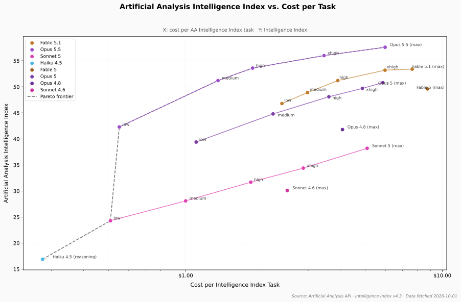
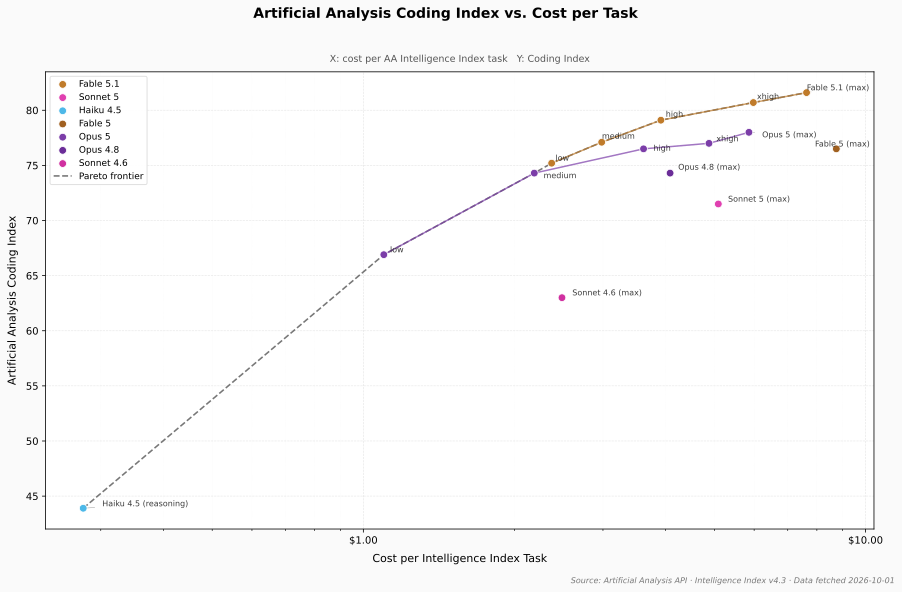

# opencode-vnaipro

OpenCode plugin for [VNAI Pro](https://vibi.top) — unified access to Claude models with pre-configured token pricing, context limits, prompt caching support, and authentication.

---

## Performance

<small>

Benchmark data from [Artificial Analysis](https://artificialanalysis.ai). X-axis: cost per AA Intelligence Index task. Run `python scripts/plot.py --refresh` to update.

</small>

**Intelligence Index vs. Cost**



**Coding Index vs. Cost**



---

## Features

- **Zero Boilerplate**: Injects `vnaipro` provider configuration into OpenCode automatically. No need to maintain huge model blocks in your `opencode.jsonc`.
- **Accurate Token Pricing**: All models are pre-configured with exact input, output, cache-read, and cache-write rates based on the [VNAI Pro pricing table](https://vibi.top/api/pricing).
- **Accurate Context Windows**: Models are configured with true context limits (up to 1M+ tokens) and appropriate output ceilings.
- **Resilient Request Fetching**: Scoped automatic retries with exponential backoff and jitter for transient gateway errors (429 rate limits, 502/503/504 gateway errors).
- **Secure Key Management**:
  - `opencode auth login` (stored in OpenCode's secure auth store)
  - `/connect` inside OpenCode (provider ID `vnaipro`)
  - `VNAIPRO_API_KEY` or `VIBI_API_KEY` environment variable
  - Optional `provider.vnaipro.options.apiKey` override

---

## Installation

Add this plugin to your `~/.config/opencode/opencode.jsonc`:

```jsonc
{
  "$schema": "https://opencode.ai/config.json",
  "plugin": [
    "opencode-vnaipro"
  ]
}
```

Or for local development / git clone:

```jsonc
{
  "$schema": "https://opencode.ai/config.json",
  "plugin": [
    "/home/christian/git/opencode-vnaipro"
  ]
}
```

### OpenCode V2

The package root entrypoint remains the V1 plugin. The V2 plugin lives in `v2/` and can be loaded alongside it:

```jsonc
{
  "$schema": "https://opencode.ai/config.json",
  "plugins": [
    "/absolute/path/to/opencode-vnaipro/v2"
  ]
}
```

For the optional V2 TUI credential toasts, add the package root to `~/.config/opencode/cli.json`:

```json
{
  "$schema": "https://opencode.ai/v2/cli.json",
  "plugins": ["/absolute/path/to/opencode-vnaipro"]
}
```

V2 uses native integrations for credentials: `/connect` or `opencode auth login`. Both entrypoints can run from the same checkout.

---

## Authentication

You can authenticate in any of the following ways:

### 1. Interactive Login (Recommended)

Run:

```bash
opencode auth login
```

Select **VNAI Pro API key** and enter your `sk-...` API key.

Alternatively, use OpenCode's built-in connect command:
Run `/connect` inside OpenCode, select **Other**, enter provider ID **`vnaipro`**, and paste your API key.

### 2. Environment Variable

Export `VNAIPRO_API_KEY` (or `VIBI_API_KEY`):

```bash
export VNAIPRO_API_KEY="sk-..."
```

### 3. Config File (Optional)

If you prefer keeping your key in `opencode.jsonc`:

```jsonc
{
  "provider": {
    "vnaipro": {
      "options": {
        "apiKey": "sk-..."
      }
    }
  }
}
```

---

## Supported Models

### Benchmark Results

<small>

Intelligence and coding scores from [Artificial Analysis](https://artificialanalysis.ai). Cost is per AA Intelligence Index task. Intel/Cost = intelligence ÷ cost (higher = better value). Models without AA data yet are omitted.

<!-- BEGIN BENCHMARK TABLE -->
| Model | Effort | Intelligence | Coding | Cost/Task | Intel/Cost |
|---|---|---|---|---|---|
| Claude Fable 5.1 | low<br>medium<br>high<br>xhigh<br>max | 46.8<br>48.9<br>51.2<br>53.2<br>53.4 | 75.2<br>77.1<br>79.1<br>80.7<br>81.6 | $2.37<br>$2.98<br>$3.91<br>$5.98<br>$7.63 | 20<br>16<br>13<br>9<br>7 |
| Claude Opus 5.5 | low<br>medium<br>high<br>xhigh<br>max | 42.3<br>51.2<br>53.6<br>56.0<br>57.6 | —<br>—<br>—<br>—<br>— | $0.551<br>$1.34<br>$1.82<br>$3.46<br>$5.98 | 77<br>38<br>29<br>16<br>10 |
| Claude Sonnet 5 | low<br>medium<br>high<br>xhigh<br>max | 24.3<br>28.1<br>31.7<br>34.4<br>38.2 | —<br>—<br>—<br>—<br>71.5 | $0.509<br>$0.999<br>$1.79<br>$2.87<br>$5.09 | 48<br>28<br>18<br>12<br>8 |
| Claude Haiku 4.5 | non-reasoning<br>reasoning | 15.4<br>16.9 | —<br>43.9 | —<br>$0.277 | —<br>61 |
| Claude Fable 5 | max | 49.6 | 76.5 | $8.75 | 6 |
| Claude Opus 5 | low<br>medium<br>high<br>xhigh<br>max | 39.4<br>44.8<br>48.1<br>49.7<br>50.8 | 66.9<br>74.3<br>76.5<br>77.0<br>78.0 | $1.10<br>$2.19<br>$3.61<br>$4.88<br>$5.86 | 36<br>20<br>13<br>10<br>9 |
| Claude Opus 4.8 | max | 41.8 | 74.3 | $4.08 | 10 |
| Claude Opus 4.7 | high<br>max | 30.9<br>40.7 | —<br>73.6 | —<br>— | —<br>— |
| Claude Opus 4.6 | high<br>max | 26.4<br>31.9 | —<br>— | —<br>— | —<br>— |
| Claude Sonnet 4.6 | low<br>high<br>max | 23.3<br>24.7<br>30.1 | —<br>—<br>63.0 | —<br>—<br>$2.49 | —<br>—<br>12 |
<!-- END BENCHMARK TABLE -->

</small>

### Pricing

<small>

<!-- BEGIN PRICING TABLE -->
| Model ID | Name | Context | Output | In $/1M | Out $/1M | Cache Read | Cache Write |
|---|---|---|---|---|---|---|---|
| `vnaipro/claude-fable-5-1` | Claude Fable 5.1 | 1M | 65K | $10.00 | $50.00 | $0.25 | $12.50 |
| `vnaipro/claude-opus-5-5` | Claude Opus 5.5 | 1M | 128K | $6.00 | $30.00 | $0.85 | $7.50 |
| `vnaipro/claude-sonnet-5` | Claude Sonnet 5 | 1M | 65K | $2.50 | $12.50 | $0.30 | $3.50 |
| `vnaipro/claude-haiku-4-5-20251001` | Claude Haiku 4.5 | 204K | 8K | $1.20 | $6.00 | $0.20 | $1.50 |
| `vnaipro/claude-fable-5` | Claude Fable 5 | 1M | 65K | $11.00 | $55.00 | $1.20 | $15.00 |
| `vnaipro/claude-opus-5` | Claude Opus 5 | 1M | 65K | $6.00 | $30.00 | $0.85 | $7.50 |
| `vnaipro/claude-opus-4-8` | Claude Opus 4.8 | 1M | 65K | $6.00 | $30.00 | $0.60 | $7.50 |
| `vnaipro/claude-opus-4-7` | Claude Opus 4.7 | 1M | 128K | $6.00 | $30.00 | $0.60 | $6.50 |
| `vnaipro/claude-opus-4-6` | Claude Opus 4.6 | 1M | 128K | $6.00 | $30.00 | $0.60 | $6.50 |
| `vnaipro/claude-sonnet-4-6` | Claude Sonnet 4.6 | 1M | 65K | $3.30 | $16.50 | $0.40 | $4.13 |
<!-- END PRICING TABLE -->

</small>

---

## License

MIT
